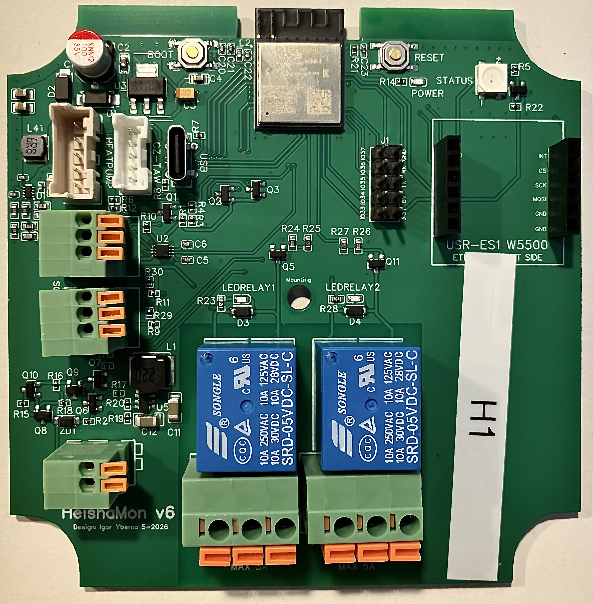
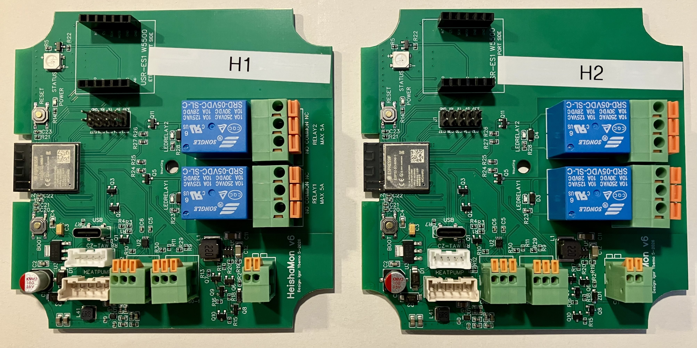
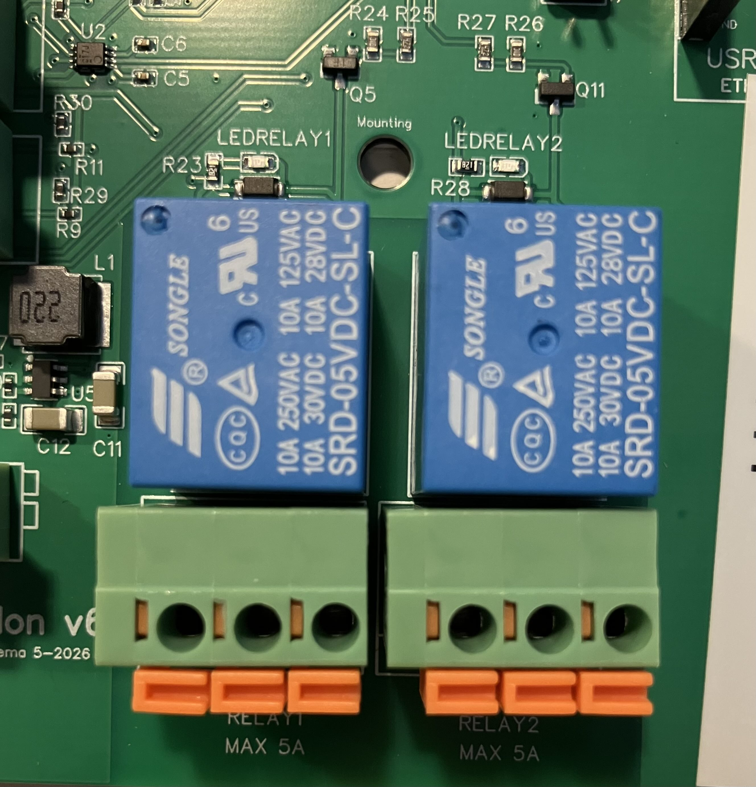

# HeishaMonKaskade

Eine Variante von [HeishaMon](https://github.com/Egyras/HeishaMon) für den
**Kaskadenbetrieb zweier Panasonic-Wärmepumpen** an einer übergeordneten
Steuerung (Node-RED/ioBroker). Läuft auf dem offiziellen
HeishaMon-ESP32-S3-Board.

> **Zugeschnitten heißt nicht festgelegt.** Set-Kommandos und Topics stehen in
> je einer Tabelle, Gerätespezifisches in Build-Flags — ein eigenes Topic ist
> eine Zeile, kein Umbau. Wie das geht, steht unter
> [Anpassen ist der Normalfall](#anpassen-ist-der-normalfall-nicht-der-sonderfall).

<p align="center">
  
</p>

<p align="center">
  <em>HeishaMon v6, Design Igor Ybema. Die Buchse <code>HEATPUMP</code> führt zum
  CN-CNT-Anschluss der Wärmepumpe — von dort kommen alle fünf Sekunden die
  203 Bytes, um deren Deutung es hier geht. Der Sockel für die
  Ethernet-Platine bleibt leer, angebunden wird über WLAN.</em>
</p>

---

## In English — what this is and whether it is for you

This is a fork of HeishaMon, reworked for a **cascade of two heat pumps driven
by an external controller** that sends several set commands at once, repeatedly,
forever. That use case exposed problems the original firmware does not show in
single-unit, hand-operated setups. The most important one:

> **Set topics that share a protocol byte silently overwrote each other.**
> Upstream assigns the whole byte; every other field in it falls back to
> `0 = no change`. Two set commands inside the same 500 ms collection window
> therefore cancelled each other — while the log still cheerfully confirmed both.
> This fork merges each value through a bit mask (`src/setcommands.h`).
> Measured proof: [`test/README.md`](test/README.md).

Other notable changes: range validation for every set command (with limits
*measured on the machine*, not copied from folklore), one data-driven table per
concern instead of four parallel arrays, no heap allocation in the decode path,
per-unit configuration via build flags, a CDN-free authenticated web UI, and a
set of diagnostic tools under `test/`.

**Not a drop-in replacement — but built to be re-cut.** It is tailored to one
specific installation (two units, no zone 2, a Node-RED cascade controller),
topic numbering has deliberate gaps, and the defaults are ours. Re-cutting it is
the easy part, though: every set command is one row in `setCommands[]` (byte,
bit mask, conversion, topic name, min, max), every published value one row in
`stateTopics[]`, and per-unit names live in build flags rather than in the code.
Take the ideas and the measurements, not the binary. Everything is documented —
the changelog in [`src/version.h`](src/version.h) explains not just *what*
changed but *why*, and what was measured to confirm it.

Documentation is in German from here on. The MQTT reference
[`MQTT-Topics.md`](MQTT-Topics.md) is in English.

---

## Worum es geht

Zwei Panasonic-Wärmepumpen laufen als Kaskade — WH-MDC05H3E5, 5-kW-Monoblöcke
und damit die Baureihe, mit der HeishaMon seinerzeit angefangen hat. Wer sie
führt, wann welche zuschaltet, mit welcher Vorlauftemperatur und welcher
Pumpendrehzahl — das entscheidet eine Steuerung in Node-RED unter ioBroker.
HeishaMonKaskade ist die **Schnittstelle** dazwischen: je ein Mikrocontroller
pro Wärmepumpe, angebunden an deren CN-CNT-Anschluss, der das
Panasonic-Protokoll nach MQTT übersetzt und Kommandos in die Gegenrichtung.

```
   Node-RED / ioBroker                MQTT-Broker            HeishaMonKaskade        Wärmepumpe
   (Kaskadenlogik, Wächter)  <---->   (hier: ioBroker-  <---->  Stufe 1 (ESP32)  <---->  WP1
                                       mqtt-Adapter)      <---->  Stufe 2 (ESP32)  <---->  WP2
```

<p align="center">
  
</p>

<p align="center">
  <em>Stufe 1 und Stufe 2 tragen denselben Quelltext; der Unterschied sind drei
  Build-Flags (MQTT-Präfix, Web-Titel, Hostname). Auch die beiden
  Ersatzplatinen tragen den Build ihrer Stufe, ein toter MQTT-Port legt sie
  still (<a href="Ablauf-Backup-Boards.md">Ablauf-Backup-Boards.md</a>).</em>
</p>

Die Wärmepumpen-Firmware selbst ist Panasonic-Code und wird nicht angefasst.
Sicherheitsrelevante Vorgänge (Abtauen, Frostschutz) entscheidet die Wärmepumpe
allein.

Was diesen Einsatz von der üblichen HeishaMon-Nutzung unterscheidet: Die
Steuerung schickt **mehrere Set-Kommandos gleichzeitig**, an **zwei Geräte**,
und wiederholt den kompletten Sollzustand **alle 5 Minuten** (Re-Assert). Dieses
Muster macht Fehler sichtbar, die im Einzelbetrieb mit Handbedienung niemandem
auffallen. Dazu kommt die Zeitachse: Die Bridges hängen im Keller, ohne
Bildschirm, und sollen **Monate am Stück** laufen. Die Frage ist nicht
„funktioniert es?“, sondern „würde ich es mitbekommen, wenn nicht?“ — die
Antworten stehen unter [Besonderheiten](#besonderheiten-im-ist-zustand).

## Anpassen ist der Normalfall, nicht der Sonderfall

Diese Firmware ist für *eine* Anlage konfiguriert — aber so gebaut, dass das
Umkonfigurieren die leichteste Übung daran ist. Ein Set-Kommando sieht
vollständig so aus ([`src/setcommands.h`](src/setcommands.h)):

```c
// Nr pos mask conversion    topic-name     min  max  param
{ 3,  7, 0xFF, CONV_MUL_INC, "QuietMode",     0,   3,   8}, // level -> (n+1)*8
```

Protokollbyte 7, Bitmaske, Umrechnung, Topic-Name, erlaubter Bereich — mehr
nicht. Abonnement und Bereichsprüfung laufen über dieselbe Tabelle. Die
gelesenen Werte genauso: eine Zeile je Topic in `stateTopics[]`
([`src/decode.cpp`](src/decode.cpp)), mit Byte, Dekodierer und Klartextliste.
Was ein Gerät von seinem Nachbarn unterscheidet (MQTT-Präfix, Hostname, Titel
der Weboberfläche), steht in Build-Flags in `platformio.ini`.

| Vorhaben | Aufwand |
| --- | --- |
| Eigene Topic-Namen, eigenes MQTT-Präfix | Build-Flags, kein Code |
| Ein Set-Kommando ergänzen | eine Zeile in `setcommands.h` (die Tabellenprüfung bricht den Build bei einem Tippfehler) |
| Ein Topic ergänzen | eine Zeile in `decode.cpp` + Zeilenzahl in `decode.h` (ein `static_assert` vergleicht sie mit der Tabelle) |
| Zone 2 zurückholen | die entfernten Tabellenzeilen wieder eintragen |

Wenn unklar ist, *welches* Byte man braucht, helfen die Werkzeuge in
[`test/`](test/README.md): `byte_monitor.py` zeigt am laufenden Gerät, welches
Byte sich bewegt, wenn man am Bedienteil etwas verstellt; `top_watch.py`
schreibt den Verlauf im 5-Sekunden-Takt mit; `tablesnap.py` macht die Abnahme
nach dem Flashen zu einem `diff`. So sind die Wertebereiche in diesem Repo
entstanden: gemessen, nicht abgeschrieben.

## Was gegenüber dem Original anders ist

| Thema | Original | Hier |
| --- | --- | --- |
| Gleichzeitige Set-Kommandos | Byte wird als Ganzes zugewiesen — Felder löschen sich gegenseitig | Bitgenauer Merge über Maskenspalte, Konflikt-Warnung im Log |
| Wertebereiche | keine Prüfung (`cmd[75] = wert + 128`) | Min/Max je Kommando, an der Anlage ausgemessen |
| Tabellen | Set-Kommandos im Code verteilt, State-Topics in vier Parallel-Arrays | je eine Tabelle (`setCommands`, `stateTopics`) |
| Zonen | Zone 1 + Zone 2 | nur Zone 1 (Anlage hat keine zweite Zone) |
| Hardware | getrennte Codebasen je Board | nur ESP32-S3 (der ESP8266-Stand liegt unter dem Tag `v3.15.0`) |
| Web-UI | jQuery/CSS vom CDN | inline, ohne externe Abhängigkeiten, mit Auth |
| Dekodierpfad | `String`-Objekte | feste Puffer, keine Heap-Allokation |
| Empfangenes Telegramm | Prüfsumme entscheidet allein | zusätzlich Typ (0x71) und Länge (203) |
| Serielle Strecke | Abriss fällt nicht auf, alte Werte bleiben stehen | Zähler und Alter des letzten gültigen Telegramms als Topics |
| WLAN-Ausfall | keine Prüfung im Betrieb | Watchdog: Reconnect nach 30 s, Neustart nach 5 min |
| `loop()` hängt | niemand merkt es | Task-Watchdog setzt nach 120 s zurück; Telnet wartet nie auf einen Client |
| Byte 110 | nicht dekodiert | vier Topics mit den Ist-Zuständen (heizt/kühlt tatsächlich) |
| Broker weg | nur eine Zeile im MQTT-Log, die niemanden erreicht | die Weboberfläche sagt es: „Hausteuerung seit 14 Minuten nicht erreichbar“ |
| Steuerung rechnet nicht mehr | fällt gar nicht auf | erkannt am ausbleibenden 5-min-Re-Assert, eigener Text auf der Seite |
| Heizstab-Auftrag beim Notbetrieb | kennt keinen Notbetrieb | wird als eigener Schritt zurückgenommen, bevor die Anlage anläuft |
| Mischer und Pumpe am KNX beim Notbetrieb | kennt keinen Notbetrieb | letzter Schritt per KNXnet/IP-Tunneling, am Aktor zurückgelesen |
| Unbemerkte Neustarts | keine Spur — das Gerät ist binnen Sekunden wieder „Online“ | Bootzähler und Reset-Ursache als Topics |
| Notbetriebswerte nach einem Neustart | kennt keinen Notbetrieb | überleben im RTC-Speicher; erst ein Stromausfall räumt sie weg |
| Logzeilen bei weggefallenem Broker | verschwinden still | Ringpuffer im RAM, Route `/log`, zusätzlich Telnet |

**Die Nummerierung der Topics hat Lücken, und das ist Absicht.** Jedes Topic
behält seine Nummer, auch wenn Zeilen entfallen (Zone 2, `TOP66`): So gelten
`MQTT-Topics.md`, ältere Mitschnitte und die Nummern des Originals weiter. Bitte
nicht durchnummerieren — die TOP-Nummer ist ein Datenfeld, kein Array-Index.

## Besonderheiten im Ist-Zustand

Hier steht, was heute gilt und warum — nicht, wie es dazu kam. Problem,
Nachweis und Messung je Änderung stehen im Changelog von
[`src/version.h`](src/version.h) und in den `Vorhaben-*`/`Arbeitsplan-*`-Dateien
(Tabelle unter [Aufbau](#aufbau)).

**Bitgenaues Mischen.** Mehrere Set-Topics teilen sich ein Protokollbyte in
verschiedenen Bitgruppen (Byte 4, 5, 8, 9). Als Ganzes geschrieben, löschen sich
Felder still gegenseitig; der 5-Minuten-Re-Assert trifft das zuverlässig. Hier
trägt jedes Kommando eine Maske in `setCommands[]`, Kommandos im selben
Sammelfenster (500 ms, Deckel 2 s) gehen in **ein** Telegramm. Ausnahme Byte 7:
`QuietMode`/`PowerfulMode` überlappen im Protokoll selbst, dort warnt die
Firmware nur. Regeln in [`src/setcommands.h`](src/setcommands.h) und
[`src/sendwindow.h`](src/sendwindow.h), Nachweis in [`test/README.md`](test/README.md).

**Wertebereiche.** Die Wärmepumpe **klemmt Werte außerhalb ihres Bereichs
kommentarlos auf den Rand**, ein falscher Wert verschwindet also lautlos. Jedes
Set-Kommando hat Min/Max, ausgemessen mit
[`test/kurven_grenzen.py`](test/kurven_grenzen.py); zwei verbreitete Angaben
stimmen nicht (`Z1HeatCurveOutsideHighTemp` gilt *bis* 15, `-15 … 15`;
`Z1CoolCurveOutsideHighTemp` `15 … 30`). **Set-Werte sind Ganzzahlen innerhalb
der Grenzen; alles andere wird abgelehnt, nicht gerundet.** Bei den Kurven sind
die Feldnamen über Kreuz zugeordnet (`Target_High` = Vorlauf bei **kaltem**
Wetter); die Firmware warnt bei verdrehter Kurve, sperrt aber nicht.
Einzelheiten: [`MQTT-Topics.md`](MQTT-Topics.md).

**Nur echte Antworttelegramme.** Typ `0x71`, Länge 203 werden **vor** der
8-Bit-Prüfsumme geprüft ([`src/telegram.h`](src/telegram.h)), der UART-Puffer
wird vor jedem Senden geleert. Die Strecke meldet ihre Gesundheit unter
`<präfix>/info/` (`telegram_ok`, `telegram_err`, `telegram_timeout`,
`telegram_age`). Nach **30 s ohne gültiges Telegramm** ist der Notbetriebsknopf
gesperrt („Keine Verbindung zur Wärmepumpe“, an beiden Stufen gleich), und ein
Schritt gilt erst als bestätigt, wenn **seit seinem Absetzen** ein gültiges
Telegramm kam ([`src/serielle_strecke.h`](src/serielle_strecke.h)).

**Karenzfenster nach dem Verbinden.** Der ioBroker-MQTT-Adapter beantwortet
**jedes neue Abonnement aus seiner Objektdatenbank** und schickt den
gespeicherten Wert jedes Set-Topics hinterher, teils Monate alt und ohne
Retain-Flag. Ungefiltert sprang der Vorlauf-Sollwert nach jedem Neustart auf die
Werksvorgabe 55 °C. Deshalb verwirft die Firmware Set-Kommandos **5 s ab dem
SUBACK**; ein im Fenster wirklich gemeintes Kommando holt der Re-Assert nach.
Die Regel ([`src/karenz.h`](src/karenz.h)) arbeitet mit **Startzeit plus
Merker**, nicht mit einem vorzeichenbehafteten `millis()`-Vergleich (der kippte
nach 24,86 Tagen); das Fenster öffnet zweimal (beim Abonnieren und am Ende von
`setup()`). Feldnachweis: Anhang von
[`Arbeitsplan-Karenzfenster-3.23.1.md`](Arbeitsplan-Karenzfenster-3.23.1.md).

> **Wartungshinweis — nach jedem ioBroker-Update einmal ins Log schauen.** Die
> 5 Sekunden sind eine Wette gegen die Antwortzeit des Adapters. Braucht der
> Replay länger (größerer Objektbaum, Systemlast), laufen alte Sollwerte wieder
> durch; ein größeres Fenster würde echte Kommandos schlucken. Das
> Frühwarnsignal ist die Bilanzzeile („N wiedereingespielte Set-Kommandos nach
> dem Verbinden verworfen“): Sie muss **vor** den ersten echten Kommandos
> kommen. Einen Reconnect mitschneiden (Telnet, Port 23); kommen die verworfenen
> Topics nicht mehr alle in derselben Sekunde wie das SUBACK, ist
> `SUBSCRIBE_GRACE` neu zu bewerten.

**Die Weboberfläche sagt, wenn die Hausteuerung weg ist.** Ohne Steuerung heizt
die Wärmepumpe mit dem letzten Sollwert weiter, die Folgen kommen mit
Verzögerung. Regeln in [`src/verbindung.h`](src/verbindung.h): Broker weg →
Hinweis nach **5 min** Karenz („seit dem Neustart“ statt einer Zahl, wenn nie
verbunden; Deckel bei 30 Tagen wegen des `millis()`-Überlaufs). Broker da, aber
**kein Re-Assert seit 12 min** (Takt 300 s, zwei verpasste Takte samt Reserve) →
„erreichbar, sendet aber keine Vorgaben“; der Wiedereinspiel-Schwall zählt nicht
als Lebenszeichen, und bei weggefallenem Broker gilt nur der Broker-Ausfall.
Notbetriebsseite zeigt die Zeile immer, die Startseite nur im Störfall.

**Notbetrieb: ein Knopf im Browser.** Fällt die Steuerung aus, trägt MQTT nicht
(der Broker *ist* der ioBroker-Adapter); der Webserver der Firmware bleibt.
**`/notbetrieb`** fährt eine Schrittfolge (Stufe 1 Heizen, Stufe 2 Warmwasser per
Build-Flag), eigener Zugang (Benutzer `notbetrieb`, Passwort als Build-Flag).
Zeitablauf und Rückkehr der Steuerung: [`Ablauf-Notbetrieb.md`](Ablauf-Notbetrieb.md).

* Die Werte kommen über `<präfix>/notbetrieb/` und liegen im RAM sowie im
  **RTC-Spiegel** ([`src/rtcspiegel.h`](src/rtcspiegel.h)), der Neustart und OTA
  überlebt, **einen Stromausfall nicht** — bewusst, damit keine Monate alten Werte
  in eine veränderte Anlage getragen werden. Fehlt einer, bleibt der Knopf
  gesperrt (lieber nicht schalten als auf die Werkskurve mit 55 °C); ebenso im
  Kühlbetrieb (`TOP101` nicht 0).
* **GRÜN heißt zurückgelesen, nicht abgesendet** — frühestens 8 s nach dem Kommando.
* **Schritt 1: Hydraulik.** Die Firmware legt den Tasmota-Switch auf 1-stufig und
  **bricht ab, wenn das nicht gelingt**: bei 2-stufiger Hydraulik schiebt der
  Warmwasserbetrieb bis zu 57 °C in die Fußbodenheizung. Dann ist an der
  Wärmepumpe nichts verstellt.
* **Schritt 2: Heizstab** (`ForceHeater = 0`), sonst schaltete der Lauf eine
  Anlage ein, an der noch ein Heizstab-Auftrag steht. Lief die Anlage mit 6 kW,
  gehört der Knopf an beide Bridges.
* **Letzter Schritt: Vorderhaus per KNX** ([`src/knxtunnel.h`](src/knxtunnel.h)):
  Zwangsstellungen von Mischer und Pumpe zurück, Mischer 50 %, Pumpe ein, am Aktor
  zurückgelesen — es zählt die Rücklesung, nicht die Busbestätigung. Scheitert er,
  zeigt die Seite GRÜN mit orangem Hinweis, damit eine KNX-Störung den Notbetrieb
  der Wärmepumpen nicht verhindert. Die Gruppenadressen stehen im Code: **Ändert
  sich in der ETS eine, braucht es eine neue Firmware.** Die KNX-Schnittstelle ist
  an beiden Stufen Pflichteinstellung ([`Analyse-KNX-Vorderhaus.md`](Analyse-KNX-Vorderhaus.md)).

**Heizstab und seine Falle.** `SET37`/`SET38` geben ihn frei (Byte 9), `SET39`
`ForceHeater` schaltet ihn an (Byte 5), alle maskiert; gemessen in
[`Vorhaben-HeaterSet.md`](Vorhaben-HeaterSet.md). Die Umwälzpumpe hängt am
**Kommando**, nicht am Stab: ein vergessenes `ForceHeater = 1` lässt sie
dauerhaft laufen. `SET39` wird nur bei ausgeschalteter Einheit angenommen —
**und solange `ForceHeater` steht, bleibt ein `Heatpump = 1` wirkungslos, ohne
Fehlermeldung.** Die Rücknahme braucht rund zehn Sekunden Abstand (Kommandos
binnen zwei Sekunden würden zu einem Telegramm). Ob ein Kommando ankam, zeigt
`TOP68` (Auftrag), nicht `TOP60` (der Stab taktet von selbst, mit 20 min Sperrzeit).

**Langzeitbetrieb sichtbar machen.** Unter `<präfix>/info/` stehen Bootzähler
(1 = stromlos gewesen, höher = Selbstneustart), Reset-Ursache, Version,
Laufzeit und vier Speicherwerte, jeweils als einzelne Zahl für ioBroker und
InfluxDB. Notbetriebszeilen gehen zuerst in einen Ringpuffer im RAM (32 Zeilen,
Route `/log`), dann ins MQTT-Log, sonst nach Telnet; die Zeitstempel kommen aus
der SNTP-Systemuhr. `loop()` darf nicht stehen: Telnet schreibt mit
`MSG_DONTWAIT` (eine Sitzung, Client ohne Lesen nach 15 s getrennt), ein
Task-Watchdog setzt eine hängende `loop()` nach 120 s zurück, der MQTT-Reconnect
blockiert nicht, und ein WLAN-Watchdog reconnectet nach 30 s und startet nach
5 min neu. Byte 110 liefert vier Ist-Zustände (`TOP99`–`TOP102`).

## Aufbau

| Datei | Inhalt |
| --- | --- |
| [`src/HeishaMon.cpp`](src/HeishaMon.cpp) | Hauptschleife, Timing-Kette, serielle Anbindung, MQTT, OTA |
| [`src/HeishaMon.h`](src/HeishaMon.h) | Plattformschicht (ESP32-S3), Timing-Konstanten |
| [`src/telegram.h`](src/telegram.h) | Typ-, Längen- und Prüfsummenregel des Antworttelegramms (auch vom Hosttest genutzt) |
| [`src/sendwindow.h`](src/sendwindow.h) | Zeitregeln des Kommando-Sammelfensters samt Deckel — arduino-frei, vom Hosttest direkt eingebunden |
| [`src/karenz.h`](src/karenz.h) | Karenzfenster nach dem Verbinden (`SUBSCRIBE_GRACE`) als Startzeit plus Merker — arduino-frei, vom Hosttest direkt eingebunden |
| [`src/telnetlog.h`](src/telnetlog.h) | Regeln der Telnet-Ausgabe ohne Warten: wann ein Client, der nicht mehr liest, als tot gilt (15 s ab dem ersten Fehlschlag) — arduino-frei, vom Hosttest direkt eingebunden |
| [`src/serielle_strecke.h`](src/serielle_strecke.h) | Gesundheit der seriellen Strecke zur Wärmepumpe: Zähler gültiger, verworfener und ausgebliebener Telegramme, Alter des letzten gültigen, Schwelle „stumm“ (30 s) — arduino-frei, vom Hosttest direkt eingebunden |
| [`src/setpayload.h`](src/setpayload.h) | Ganzzahlregel der Set-Befehle und Buchführung über abgelehnte (Zähler, letzter Befehl) — arduino-frei, vom Hosttest direkt eingebunden |
| [`src/telnetausgabe.h`](src/telnetausgabe.h), [`src/telnetausgabe.cpp`](src/telnetausgabe.cpp) | Der Telnet-Teil selbst (ersetzt seit 3.24.0 die Bibliothek `TelnetStream`): ein Client, `send(…, MSG_DONTWAIT)`, Verwerfen statt Warten |
| [`src/setcommands.h`](src/setcommands.h) | Tabelle `setCommands` — Quelle der Wahrheit für alle Set-Kommandos —, Umrechnung, Maske, Konfliktmeldung, leere Kommandovorlage und die Tabellenprüfung zur Übersetzungszeit (seit 3.25.1) — arduino-frei, vom Hosttest direkt eingebunden |
| [`src/commands.cpp`](src/commands.cpp) | Anbindung an MQTT: Set-Topics abonnieren, Payload annehmen, Logzeilen — die Regeln selbst stehen in `setcommands.h` |
| [`src/decode.cpp`](src/decode.cpp) | Tabelle `stateTopics` und die Dekodierer |
| [`src/Topics.cpp`](src/Topics.cpp) | Wurzeln der MQTT-Pfade (`state`, `set`, `info`) — die Topic-Namen stehen in den Tabellen |
| [`src/webfunctions.cpp`](src/webfunctions.cpp) | Weboberfläche und Einstellungen |
| [`src/verbindung.h`](src/verbindung.h) | Karenz und Ausfalldauer der Verbindung zur Hausteuerung — arduino-frei, vom Hosttest direkt eingebunden |
| [`src/notbetrieb.h`](src/notbetrieb.h) | Regeln des Notbetriebs — arduino-frei, vom Hosttest direkt eingebunden |
| [`src/notbetrieb.cpp`](src/notbetrieb.cpp) | Anbindung ans Gerät: Abonnement, Schrittfolge, Zustand |
| [`src/rtcspiegel.h`](src/rtcspiegel.h) | Gültigkeitsregel des RTC-Spiegels, der die Notbetriebswerte über einen Neustart rettet — arduino-frei, vom Hosttest direkt eingebunden |
| [`src/knxtunnel.h`](src/knxtunnel.h) | KNX-Tunnel und Rückleseregel A des Vorderhausschritts, Adressen der Anlage — arduino-frei, vom Hosttest direkt eingebunden |
| [`src/vorderhaus.cpp`](src/vorderhaus.cpp) | Netzteil des Vorderhausschritts: kurze KNXnet/IP-Verbindungen über WiFiUDP |
| [`src/version.h`](src/version.h) | Versionsnummer und ausführlicher Changelog |
| [`MQTT-Topics.md`](MQTT-Topics.md) | Topic-Referenz (englisch), aus den Tabellen nachgezogen |
| [`SET-TOP-Zuordnung.md`](SET-TOP-Zuordnung.md) | Welches State-Topic liest ein Set-Kommando zurück — und wo keines existiert |
| [`Byte-Zuordnung.md`](Byte-Zuordnung.md) | Byte 1–202 der Antwort mit allen Bitgruppen: welches Set-Kommando schreibt, welches State-Topic liest, was unbelegt ist |
| [`Vorhaben-Byte28-Betriebsart.md`](Vorhaben-Byte28-Betriebsart.md) | Kurve ↔ Direkt als Set-Kommando — vollständig erledigt in 3.11.0, beide Kommandos am Gerät belegt |
| [`Vorhaben-HeaterSet.md`](Vorhaben-HeaterSet.md) | Heizstab über MQTT (SET37–SET39) — Entwurf, Messungen und Entscheidungen; erledigt in 3.17.0 |
| [`Vorhaben-Nur-ESP32-Pfad.md`](Vorhaben-Nur-ESP32-Pfad.md) | ESP8266-Pfad aus Code, Build, CI und Doku entfernt — Planung und Entscheidungen; erledigt in 3.16.0 |
| [`Vorhaben-Notbetrieb-Weboberflaeche.md`](Vorhaben-Notbetrieb-Weboberflaeche.md) | Notbetrieb per Browser — Entwurf, Messungen und die Protokolle der Läufe an der Anlage; erledigt in 3.12.0 |
| [`Vorhaben-Doku-Konsistenz.md`](Vorhaben-Doku-Konsistenz.md) | Doku, Memory und Code beisammenhalten — Prüfungen, pre-commit-Hook, Memory-Umbau und Abschluss-Skill, erledigt (2026-09-18) |
| [`Ablauf-Backup-Boards.md`](Ablauf-Backup-Boards.md) | Die zwei Ersatzplatinen: Pflege bei jeder Änderung, Tausch im Ernstfall |
| [`Ablauf-Notbetrieb.md`](Ablauf-Notbetrieb.md) | Was beim Druck auf den Knopf und bei der Rückkehr der Steuerung Schritt für Schritt passiert, mit Zeiten |
| [`Anlauf-H1-2026-09-19.md`](Anlauf-H1-2026-09-19.md) | Ein vollständiger Kaltstart der Stufe 1, mit `top_watch.py` mitgeschnitten: Frequenz, therm. Leistung, Vor- und Rücklauf auf dem Zeitstrahl |
| [`Vorhaben-Hydraulik-Notbetrieb.md`](Vorhaben-Hydraulik-Notbetrieb.md) | Warum der Notbetrieb die Hydraulik selbst auf 1-stufig stellt — Entwurf und Entscheidungen; erledigt in 3.15.0 |
| [`Analyse-KNX-Vorderhaus.md`](Analyse-KNX-Vorderhaus.md) | KNX-Schritt „Vorderhaus": Recherche, Vorabtest an der Anlage, Entwurf, Rückleseregel A; umgesetzt in 3.21.0 nach [`Arbeitsplan-KNX-Vorderhaus.md`](Arbeitsplan-KNX-Vorderhaus.md) |
| [`Arbeitsplan-KNX-Vorderhaus.md`](Arbeitsplan-KNX-Vorderhaus.md) | Umsetzung des Vorderhausschritts vom ersten Befehl bis zum Rollout; ausgerollt als 3.21.0 |
| [`Analyse-Relais-statt-KNX.md`](Analyse-Relais-statt-KNX.md) | Die zwei Relais der Platine statt des KNX-Aktors — geprüft und verworfen (2026-08-23) |
| [`Arbeitsplan-Notbetrieb-NodeRED.md`](Arbeitsplan-Notbetrieb-NodeRED.md) | Node-RED-Seite des Notbetriebs (Werte-Sender, Verteiler-Ausgang) — erledigt am 2026-08-20 im Projekt `nodered-flows` |
| [`Arbeitsplan-Robustheit-3.20.0.md`](Arbeitsplan-Robustheit-3.20.0.md) | Umsetzung der Durchsicht vom 2026-09-02 (M1–M4) samt Nachweisen; 3.20.0 |
| [`Arbeitsplan-AltExternalSensor.md`](Arbeitsplan-AltExternalSensor.md) | Alternativer Außenfühler als SET40/TOP112, TOP66 entfällt — Entscheide und Ablauf bis zum Release; ausgerollt als 3.23.0 |
| [`Arbeitsplan-Build-Hygiene-3.23.2.md`](Arbeitsplan-Build-Hygiene-3.23.2.md) | Bibliotheken pinnen, Compiler-Warnungen wieder an, tote Zweige und veraltete Kommentare (Paket P2 der Durchsicht 2026-10-15) — erledigt, 3.23.2 am 2026-10-16 ausgerollt |
| [`Arbeitsplan-Loop-Stillstand-3.24.0.md`](Arbeitsplan-Loop-Stillstand-3.24.0.md) | Telnet-Ausgabe nicht blockierend (S2), Watchdog für `loop()` (S3) — Paket P3 der Durchsicht 2026-10-15 — erledigt, 3.24.0 am 2026-10-16 ausgerollt |
| [`Arbeitsplan-Serielle-Strecke-3.25.0.md`](Arbeitsplan-Serielle-Strecke-3.25.0.md) | Serielle Strecke überwacht (S4), abgelehnte Set-Befehle sichtbar (S6) — Paket P4 der Durchsicht 2026-10-15 — erledigt, 3.25.0 am 2026-10-17 ausgerollt |
| [`Arbeitsplan-Kommandopfad-3.25.1.md`](Arbeitsplan-Kommandopfad-3.25.1.md) | Kommandopfad als arduino-freier Header (C1, C5b, C5c) — Paket P5 der Durchsicht 2026-10-15 — ohne Funktionsänderung — erledigt, 3.25.1 am 2026-10-18 ausgerollt |
| [`Arbeitsplan-Karenzfenster-3.23.1.md`](Arbeitsplan-Karenzfenster-3.23.1.md) | Karenzfenster nach dem Subscribe überlaufsicher machen (Befund S1 der Durchsicht 2026-10-15) — erledigt, 3.23.1 am 2026-10-15 ausgerollt |
| [`Auftrag-Befehlswaechter-AltExternalSensor.md`](Auftrag-Befehlswaechter-AltExternalSensor.md) | Auftrag an `nodered-flows`: SET40/TOP112 in den `WP_Befehls_Waechter` aufnehmen — erledigt am 2026-09-19 im Projekt `nodered-flows` |
| [`Auftrag-Notbetriebssender-Ganzzahl.md`](Auftrag-Notbetriebssender-Ganzzahl.md) | Auftrag an `nodered-flows`: Notbetriebswerte-Sender rundet die Kurvenwerte auf Ganzzahlen, weil die Firmware Dezimalwerte verwirft — erledigt am 2026-10-15 im Projekt `nodered-flows` (V1.1) |
| [`Auftrag-Waechter-Serielle-Strecke.md`](Auftrag-Waechter-Serielle-Strecke.md) | Auftrag an `nodered-flows`: Wächter auf `info/telegram_*` und `info/set_abgelehnt*` — erledigt am 2026-10-17 im Projekt `nodered-flows` (V1.5.0) |
| [`Auftrag-Heizstab-Notbetrieb.md`](Auftrag-Heizstab-Notbetrieb.md) | Auftrag aus `nodered-flows`: der Notbetrieb nimmt SET39 zurück — beantwortet, gebaut in 3.18.0 |
| [`Auftrag-Wartungsschalter-NodeRED.md`](Auftrag-Wartungsschalter-NodeRED.md) | Re-Assert-Sperre bei Wartung — beantwortet am 2026-08-20: die Sperre war nie eingeschaltet |
| [`Massnahmenplan-Codedurchsicht-2026-08-18.md`](Massnahmenplan-Codedurchsicht-2026-08-18.md) | Erste Codedurchsicht: Befunde mit Entscheid je Punkt, auch für die verworfenen; umgesetzt bis 3.9.0 |
| [`Massnahmenplan-Codedurchsicht-2026-09-02.md`](Massnahmenplan-Codedurchsicht-2026-09-02.md) | Zweite Durchsicht (Robustheit, Langzeitstabilität): Befunde mit Entscheid je Punkt; umgesetzt in 3.20.0 |
| [`Massnahmenplan-Codedurchsicht-2026-10-15.md`](Massnahmenplan-Codedurchsicht-2026-10-15.md) | Dritte Durchsicht (Langzeitstabilität, Code, Doku): Befunde mit Empfehlung, geordnet in Pakete P1–P7; der Stand je Befund steht in der Übersicht des Dokuments |
| [`test/`](test/README.md) | Diagnose- und Nachweiswerkzeuge, Hosttests |
| [`.githooks/`](.githooks/pre-commit) | pre-commit-Hook: `test/hosttests.sh --schnell` vor jedem Commit, auch vor reinen Doku-Commits; einmal je Klon aktivieren mit `git config core.hooksPath .githooks` |
| [`ProtocolByteDecrypt.md`](ProtocolByteDecrypt.md) | Notizen zum Protokoll auf Byte-Ebene |

Zeitverhalten (Konstanten in `HeishaMon.h`): alle 5 s eine Abfrage an die
Wärmepumpe, 500 ms Sammelfenster für eingehende Set-Kommandos (Deckel 2 s),
600 ms Timeout für die 203 Bytes Antwort. Gesendet wird immer nur eine Sache zur
Zeit — `serialquerysent` wirkt als Mutex; fällt ein Sendezeitpunkt in ein
laufendes Lesefenster, wird das Senden verschoben, statt die eingetroffene
Antwort wegzuwerfen. Die Zeitregeln stehen in `src/sendwindow.h`, damit
Firmware und Hosttest dieselbe Fassung benutzen.

## Bauen und Flashen

Gebaut wird mit [PlatformIO](https://platformio.org/). Die gerätespezifischen
Zugangsdaten liegen in `platformio_user_env.ini` (nicht in git); Vorlage ist
`platformio_user_env_sample.ini`:

```bash
cp platformio_user_env_sample.ini platformio_user_env.ini
```

Darin stehen die Upload-Ziele (`[usb32_defaults]`, `[ota32_defaults_h1|h2|test]`)
und zwei Passwörter: `[ap_defaults]` (Setup-Hotspot) und `[notbetrieb_defaults]`
(Notbetriebsknopf). Alle sechs Sektionen müssen vorhanden sein, auch wenn nur ein
Board benutzt wird — `platformio.ini` referenziert sie alle.

`platformio.ini` ist in Bausteine gegliedert: Board-Basis (`[esp32_base]`),
Stufen-Identität (`[stage_h1]`, `[stage_h2]`, `[stage_test_esp32]`) und darauf
aufbauend die Envs. Die Werte sind die dieser Anlage und dienen als Beispiel:

| Env | Zweck |
| --- | --- |
| `heishamon_esp32_h1_ota`, `heishamon_esp32_h2_ota` | Produktiv: Stufe 1 an WP1, Stufe 2 an WP2, Update per OTA |
| `heishamon_esp32_h1_usb`, `heishamon_esp32_h2_usb` | Flash per USB |
| `heishamon_esp32_usb` / `_ota` | Prüfstand mit eigenem MQTT-Präfix (`panasonic_heat_pump32`) |

```bash
pio run -e heishamon_esp32_h1_ota -t upload
```

Einen eigenen Prüfstand gibt es nicht; dafür wird eines der beiden Backup-Boards
geliehen. Der Ablauf hat eine sicherheitskritische Reihenfolge und steht in
[`test/README.md`](test/README.md).

Für eine eigene Anlage sind die Build-Flags der Stufen anzupassen — Präfix und
Web-Titel in der Stufen-Sektion, der Hostname im Env (mehrere Boards können
dieselbe Stufe fahren):

```ini
[stage_h1]
build_flags =
	-D HEISHA_MQTT_PREFIX='"panasonic_heat_pump"'
	-D HEISHA_STAGE_NAME='"Heisha Stufe 1"'

[env:meine_stufe]
extends = esp32_base
build_flags =
	${esp32_base.build_flags}
	${stage_h1.build_flags}
	-D HEISHA_HOSTNAME='"HeishaMon32_h1"'
```

**Für ein Testgerät ist ein eigenes Präfix Pflicht** — sonst sitzt der Prüfling
auf dem LWT- und State-Pfad der produktiven Wärmepumpe.

Nach dem Flashen richtet sich das Gerät wie das Original über einen
WiFi-Manager-Hotspot ein; MQTT-Server und Zugangsdaten stehen danach unter
`http://<ip>/settings`. Weboberfläche, Telnet-Log (Port 23) und OTA sind
verfügbar wie gewohnt.

**Der Setup-Hotspot ist mit WPA2 geschützt.** Das Passwort kommt als Build-Flag
aus `[ap_defaults]` und ist vor dem ersten Flash einzutragen (8–63 Zeichen, sonst
bricht der Build ab). Der Grund ist nicht der Erstboot: Fällt das WLAN aus,
startet der Watchdog das Gerät nach 5 min neu, der Verbindungsversuch scheitert
nach 10 s, und das Portal geht für 180 s auf — zyklisch, solange die Störung
dauert. Seine Felder sind mit den **echten** Werten vorbefüllt, OTA- und
MQTT-Passwort eingeschlossen. **Das AP-Passwort gehört in die Notfall-Unterlage.**

**Telnet (Port 23) verlangt keine Anmeldung** und ist deshalb bewusst nur
Beobachtungsweg: Logausgabe, die Umschalter `L` (MQTT-Log), `D` (Debug), `H`
(Hexlog), die Abfragen `M` (Speicher), `W` (WLAN-Qualität), `I` (IP) und `C`
(trennen). `R` antwortet nur mit dem Verweis auf `http://<ip>/reboot` hinter dem
Web-Login: Ein Neustart trennt die Wärmepumpe für die Dauer des Boots von der
Steuerung, das soll niemand ohne Anmeldung auslösen können.

## MQTT-Schnittstelle

99 State-Topics und 38 Set-Kommandos, Namen kompatibel zum Original-HeishaMon.
Die vollständige Referenz mit Byte-Spalte und Wertebereichen steht in
[`MQTT-Topics.md`](MQTT-Topics.md). Welches State-Topic ein Set-Kommando
zurückliest — und welche zwei Kommandos gar keine Rückmeldung haben —, steht in
[`SET-TOP-Zuordnung.md`](SET-TOP-Zuordnung.md).

```
<präfix>/info/LWT                  Online / Offline
<präfix>/info/log                  Klartext-Log (umschaltbar)
<präfix>/info/<Wert>               Langzeit-Telemetrie (Neustarts, Heap, Laufzeit, serielle Strecke, abgelehnte Set-Befehle)
<präfix>/state/<Topic>             dekodierte Werte, mit Retain-Flag
<präfix>/set/<Kommando>            Kommandos an die Wärmepumpe
<präfix>/notbetrieb/<Name>         Notbetriebswerte (nur Eingang, gehen nie von selbst an die WP)
```

Hinweise aus der Praxis:

* Die Firmware publiziert **mit Retain-Flag**. Entfällt ein Topic, friert es beim
  Broker ein, statt zu verschwinden; [`test/retained_loeschen.py`](test/retained_loeschen.py)
  räumt auf. Beim **ioBroker-mqtt-Adapter im Server-Modus** (wie hier) gibt es
  keinen getrennten Retained-Speicher: Ein Löschbefehl setzt den State nur auf
  `null`, weg ist das Topic erst, wenn das Objekt im ioBroker-Admin gelöscht wird.
* **`LWT` ist in beide Richtungen retained** (`Online` wie das Will `Offline`);
  sonst hielte ein später verbundener Abonnent (Node-RED-Neustart, Wächter) eine
  laufende Stufe für tot. Der ioBroker-Adapter verdeckt den Unterschied, ein
  mosquitto nicht. **Der Nachweis am echten Broker steht noch aus** und gehört in
  die Umzugsvorbereitung: Ein neuer Abonnent auf `<präfix>/info/LWT` muss retained
  `Online` bekommen, nach dem Stromlosmachen retained `Offline`.
* **Set-Werte sind Ganzzahlen innerhalb der Tabellengrenzen.** Ein `33.5` oder
  ein Wert außerhalb von Min/Max verwirft den ganzen Befehl; die Wärmepumpe
  behält ihren Wert, der `set`-Datenpunkt im ioBroker zeigt weiter den
  eingetippten. Dauerhaft sichtbar ist das in `<präfix>/info/set_abgelehnt`
  (Zähler seit dem Start) und `info/set_abgelehnt_letzter` (`Name=Wert`, auf 64
  Zeichen gekürzt); die Fehlerzeile steht außerdem im Ringpuffer unter `/log`.
  Ein steigender Zähler ohne Handeintrag deutet auf einen Sender mit
  Dezimalwerten hin. Der Prüfweg für Betreiber steht im anderen Repo
  `nodered-flows` (`doku/referenz/BETRIEB.md`).
* **Ein fehlgeschlagenes State-Publish wird wiederholt:** Der nächste Durchlauf
  (5 s) schickt die Tabelle erneut, statt dem Broker bis zu fünf Minuten einen
  alten, retained Wert mit dem Anschein von Gültigkeit zu lassen.

## Diagnose- und Nachweiswerkzeuge

Unter [`test/`](test/README.md) liegen Werkzeuge, die mit der Python-
Standardbibliothek auskommen — vom Hosttest für die Merge-Logik über den
Prüfstandstest bis zum passiven Mitschnitt am laufenden Gerät. Zwei Vorgehen sind
über dieses Projekt hinaus brauchbar:

* **Nachweis an einer laufenden Anlage, ohne sie zu stören:** genau die Werte
  senden, die die Steuerung ohnehin gerade kommandiert. Der Sollzustand bleibt,
  und ein Fehlschlag korrigiert sich spätestens mit dem nächsten Re-Assert.
* **Umbauten am Dekodierpfad vor dem Flashen absichern:** zwei Codestände auf dem
  Rechner übersetzen und mit identischen Telegrammen vergleichen.

`test/README.md` dokumentiert auch die Fallstricke (idempotente Sender, Hexlog
parsen, MQTT-Client-IDs bei schnellen Reconnects).

## Was bewusst nicht drin ist

<p align="center">
  
</p>

<p align="center">
  <em>Die beiden Relais der Platine schalten in dieser Anlage nichts — und das
  ist durchgerechnet, bevor jemand zum Schraubendreher griff (siehe unten).</em>
</p>

* **Zone 2** — die Anlage hat keine; die Topics trugen nur dekodiertes Rauschen.
  Die Nummerierung behält ihre Lücken (siehe oben).
* **Extras des ESP32-Boards** (1-Wire, S0-Zähler, OpenTherm) bleiben ungenutzt;
  der Sockel für die Ethernet-Platine (USR-ES1 / W5500) bleibt leer, angebunden
  wird über WLAN.
* **Die beiden Relais der Platine.** Geprüft, durchgerechnet und begründet
  verworfen — der Weg dahin steht in
  [`Analyse-Relais-statt-KNX.md`](Analyse-Relais-statt-KNX.md), samt der
  Handbuchangabe zur Kontaktlogik, die an dieser Anlage falsch herum ist.
* **Keine Unity-Testsuite.** Die Werkzeuge in `test/` sind eigenständige
  Diagnoseprogramme und Hosttests, `pio test` nutzt sie nicht.
* **Zustandsändernde Webadressen bleiben per GET erreichbar** (`/reboot`,
  `/settings`, `/togglelog`, `/toggledebug`; der Notbetrieb-Knopf ist ein
  POST-Formular). Menülinks, `curl`-Anleitungen und das ausgedruckte Notfallblatt
  leben davon. Das Risiko (eine fremde Seite ruft die Adresse bei angemeldetem
  Browser im Hintergrund auf) ist geprüft und bewusst hingenommen — Heimnetz,
  geringe Wahrscheinlichkeit, und POST allein schützt nicht vor einem gezielten
  Angriff (Owner 2026-10-18; Wiederaufmachen, wenn das Board aus fremden Netzen
  erreichbar wird). Hintergrund: [`Massnahmenplan-Codedurchsicht-2026-10-15.md`](Massnahmenplan-Codedurchsicht-2026-10-15.md), C5d.
* Ein größerer Umbauplan (RX-State-Machine, FreeRTOS-Tasks, Verify/Ack mit
  Retry, `set/batch`) wurde erarbeitet und bewusst zurückgestellt: für diesen
  Einsatzzweck zu viel Komplexität.

## Herkunft und Dank

Basis ist das Projekt [HeishaMon](https://github.com/Egyras/HeishaMon) von
Egyras und der HeishaMon-Community — ohne deren Protokollarbeit gäbe es hier
nichts. Die Hardware ist das offizielle HeishaMon-ESP32-Board; der
**Platinenentwurf stammt von Igor Ybema** (Version v6, 5-2026).

Die Umbauten dieses Forks sind in Zusammenarbeit mit **Claude Code**
entstanden. Das erklärt auch den Dokumentationsstil: Zu jeder Änderung gehört
die Begründung, der Nachweis und der Weg zurück. Das übergeordnete Ziel ist
Wartbarkeit — die Anlage soll auch von jemandem am Laufen gehalten werden
können, der ihre Entstehungsgeschichte nicht kennt.

## Kontakt

Fragen, Korrekturen und eigene Messwerte gerne als
[Issue](https://github.com/gregor-samosir/HeishaMonKaskade/issues) — dann steht
die Antwort auch für den nächsten Leser da. Besonders willkommen sind
Rückmeldungen zu den ausgemessenen Wertebereichen: Ob die Klemmgrenzen bei
anderen Modellreihen genauso liegen, weiß ich nicht.

## Lizenz

[MIT](LICENSE).

Und der übliche, hier ernst gemeinte Hinweis: Diese Firmware schreibt in eine
Heizungsanlage. Was sie an die Wärmepumpe schickt, verantwortet der Betreiber.
Vor dem ersten Einsatz an einer fremden Anlage bitte die Wertebereiche in
`src/setcommands.h` gegen das eigene Gerät prüfen — sie sind an *dieser* Anlage
ausgemessen.
